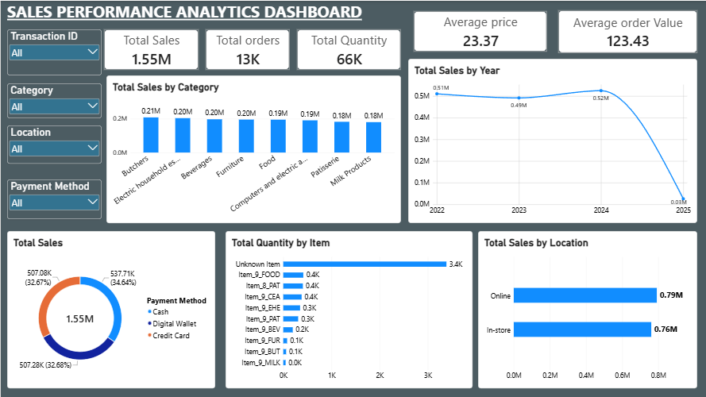

# 📊 SALES PERFORMANCE ANALYTICS DASHBOARD

### Turning Retail Sales Data into Actionable Business Insights

---

## 🚀 Project Overview

How is a retail business performing? Which product categories generate the highest revenue? Do customers prefer shopping online or in-store? Which payment methods contribute the most to sales?

This project explores these business questions through an interactive **Sales Performance Analytics Dashboard built using Microsoft Power BI**.

Using retail transaction data, I transformed sales records into meaningful visual insights to understand business performance, identify sales patterns and support data-driven decision-making.

## 🖥️ Dashboard Preview

## 🎯 Business Objectives

The primary goal of this project is to understand retail sales performance through data analysis.

- 📈 Monitor overall revenue and sales performance.
- 🛒 Identify high-performing product categories.
- 📍 Compare online and in-store sales.
- 💳 Understand customer payment preferences.
- 📅 Analyze yearly sales trends.
- 📦 Explore product-level quantity performance.
- 🔎 Enable interactive analysis using dynamic filters.

## 📂 Dataset Overview

The analysis uses a retail store sales dataset containing **12,575 transaction records and 11 columns**.

The dataset includes:

- Transaction ID and Customer ID
- Product Category and Item
- Price Per Unit and Quantity
- Total Spent
- Payment Method
- Shopping Location
- Transaction Date
- Discount Applied

These attributes allow exploration of sales performance from multiple business perspectives.

## 📌 Key Performance Indicators

The dashboard highlights five important business metrics:

- 💰 **Total Sales:** 1.55M
- 🧾 **Total Orders:** 13K
- 📦 **Total Quantity Sold:** 66K
- 🏷️ **Average Price:** 23.37
- 🛍️ **Average Order Value:** 123.43

These KPIs provide a quick overview of the overall retail business performance.

## 📊 Dashboard Insights

### 1️⃣ Category-Wise Sales Performance

Analyzed revenue generated across eight product categories.

- Butchers recorded the highest sales at approximately 0.21M.
- Electric Household Essentials and Beverages followed closely.
- Milk Products recorded approximately 0.18M.

**Business perspective:** Category-level performance can help businesses evaluate product demand and make better inventory decisions.

### 2️⃣ Yearly Sales Trends

Evaluated sales performance from 2022 to 2025.

- 2022 recorded approximately 0.51M.
- 2023 recorded approximately 0.49M.
- 2024 recorded approximately 0.52M.
- 2025 recorded approximately 0.03M.

2024 was the strongest complete calendar year.

*Note: 2025 contains only partial-year data, so its sales should not be compared directly with complete calendar years.*

### 3️⃣ Payment Method Analysis

Compared revenue generated through three payment methods:

- 💵 Cash
- 💳 Credit Card
- 📱 Digital Wallet

Cash contributed the highest revenue, approximately 537.71K.

Digital Wallet and Credit Card generated approximately 507K each.

### 4️⃣ Location-Wise Sales Analysis

Compared the performance of two sales channels:

- 🌐 Online: 0.79M
- 🏬 In-store: 0.76M

Online sales contributed slightly more revenue than in-store sales.

### 5️⃣ Product Quantity Analysis

Analyzed quantity sold across individual items to understand product-level sales patterns.

The dashboard also highlights an Unknown Item category, indicating missing product information in the source data.

## 🎛️ Interactive Dashboard Features

The dashboard includes interactive slicers that allow users to explore sales performance dynamically.

- Transaction ID
- Product Category
- Location
- Payment Method

Users can apply different filters to investigate specific sales segments and understand how business performance changes across selections.

## 🛠️ Tools & Technologies

**Microsoft Power BI**

- Dashboard development
- Interactive visualizations
- KPI reporting

**Power Query**

- Data preparation
- Data transformation

**DAX (Data Analysis Expressions)**

- Business calculations
- KPI development

**CSV Dataset**

- Retail transaction data
- Sales analysis

## 💡 Business Recommendations

Based on the observed sales patterns, the following actions could support better business decisions:

- Focus on monitoring high-revenue product categories.
- Evaluate online and in-store sales separately to identify channel opportunities.
- Monitor payment preferences to understand customer transaction behaviour.
- Investigate missing product information to improve reporting accuracy.
- Compare equivalent time periods when evaluating yearly performance.
- Regularly monitor KPIs to identify changes in business performance.

## 📁 Project Files

This repository contains:

📂 **Dataset**

- `retail_store_sales.csv` – Original retail transaction dataset.

📊 **Power BI Report**

- `sales.pbix` – Interactive Power BI dashboard file.

🖼️ **Dashboard Preview**

- `SALES_PERFORMANCE_ANALYTICS_DASHBOARD.png` – Dashboard screenshot.

📄 **README.md**

- Project overview, analysis and business insights.

## ▶️ How to Explore the Project

1. Download or clone this repository.
2. Open `sales.pbix` using Microsoft Power BI Desktop.
3. Explore the dashboard and apply different slicers.
4. Review the dataset to understand the underlying transactions.
5. Explore the business insights presented in this documentation.

## 👩‍💻 About Me

**Devika Sutar**

Aspiring Data Analyst | Power BI | SQL | Python | Excel

I enjoy exploring datasets, identifying meaningful patterns and transforming raw data into actionable business insights.

This project demonstrates my practical understanding of data analysis, business intelligence and interactive dashboard development.

---

\

&#x20; \<b>⭐ If you find this project interesting, feel free to explore the repository!\</b>
\

